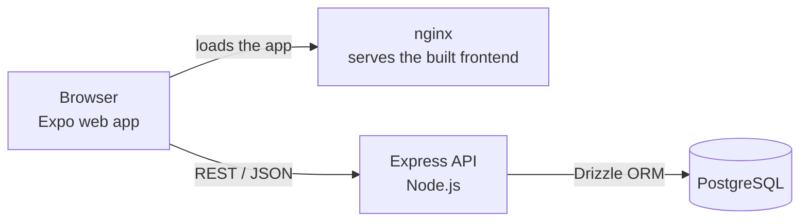
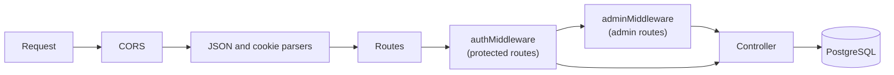
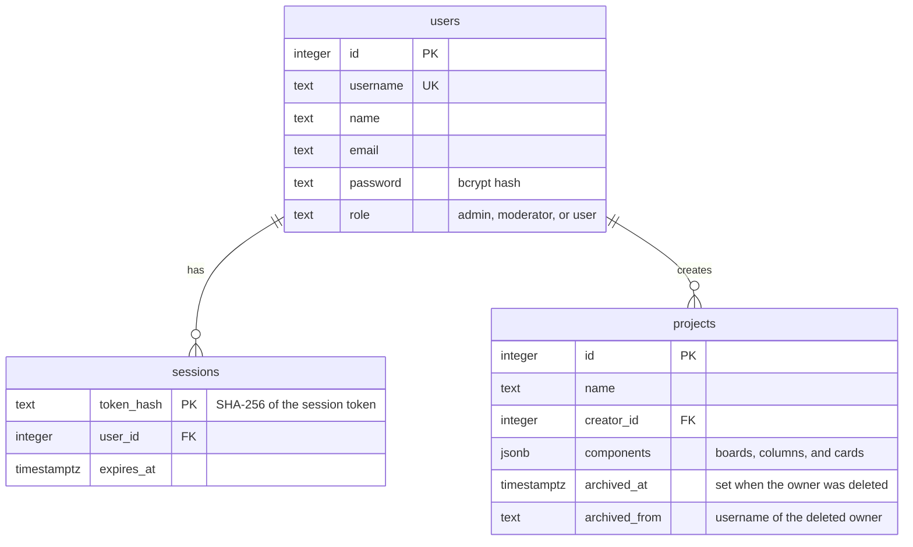
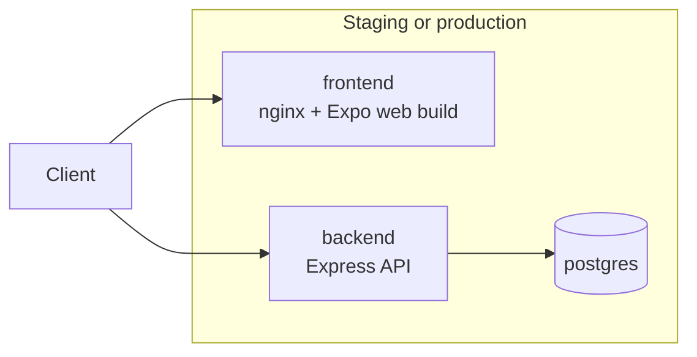

# Architecture

This document explains how Pagewise fits together. For setup, see the [README](../README.md). For the development workflow, see [CONTRIBUTING.md](../CONTRIBUTING.md).

## Table of Contents

- [Overview](#overview)
- [Monorepo Layout](#monorepo-layout)
- [Frontend](#frontend)
- [Backend](#backend)
- [Data Model](#data-model)
- [Shared Package](#shared-package)
- [Testing](#testing)
- [Deployment](#deployment)

## Overview

Pagewise is a single-page application that talks to a REST API. The API is the only part that can reach the database.



In local development, the Expo development server (Metro) serves the frontend instead of nginx, and only the database runs in Docker.

## Monorepo Layout

The repository is a [pnpm](https://pnpm.io/) workspace managed with [Turborepo](https://turbo.build/):

| Package | Path | Purpose |
|---|---|---|
| `@pagewise/frontend` | `apps/frontend` | Expo (React Native) app, for the web and mobile |
| `@pagewise/backend` | `apps/backend` | REST API |
| `@pagewise/shared` | `packages/shared` | Schemas, constants, and utilities used by both |

## Frontend

`apps/frontend` is a React Native app built with Expo. It covers login, the project list, project pages, and the board. The same code runs as a web app and in Expo Go on iOS and Android.

| Directory | Responsibility |
|---|---|
| `src/app` | Screens and layouts. Expo Router turns each file into a route |
| `src/components` | Reusable UI components |
| `src/stores` | Zustand state: `authStore`, `projectStore`, `boardStore`, and `appStore` |
| `src/services` | The Axios API client, how the API address is chosen, and token storage |
| `public` | Web-only files: the `index.html` template with the home screen app tags, the manifest, and icons |

**Authentication.** The client sends the session token as a Bearer header and never uses the cookie, so it works over plain HTTP and in native apps. The token is kept in `localStorage` on the web and in the device keychain (`expo-secure-store`) on iOS and Android. Metro picks the right file, `tokenStorage.ts` or `tokenStorage.native.ts`, for each platform.

**API address.** On the web, the client calls the API on the host the page was loaded from, at `EXPO_PUBLIC_API_PORT`. In Expo Go there is no page address, so it uses `EXPO_PUBLIC_API_URL`, or else the computer that serves the development bundle. Expo compiles `EXPO_PUBLIC_*` values into the bundle at build time.

**Logged-in routes.** The root layout loads the current user first, then uses Expo Router's protected routes: logged-out users only reach `/login`, and logged-in users everything else.

**Web build.** `expo export --platform web` creates a single-page app in `dist/`, which nginx serves (`nginx.conf`, or `nginx.staging.conf` with a password).

## Backend

The backend is an [Express 5](https://expressjs.com/) application written in TypeScript.

### Request Flow



| Directory | Responsibility |
|---|---|
| `config` | Environment checks, middleware and route registration, server startup |
| `routes` | Map URLs to controllers |
| `middleware` | Authentication and role checks |
| `controllers` | Request handling and business logic |
| `models` | Drizzle table definitions |
| `db` | Database connection, migrations, and admin seeding |
| `utils` | Session store, response helpers, and small utilities |

### API

| Base path | Purpose | Access |
|---|---|---|
| `/api/health` | Checks that the backend can reach the database: `200 { status: 'ok' }` or `503 { status: 'error' }`. Used by the Docker healthcheck, so `docker compose up --wait` in deploys waits for a working backend | Public |
| `/api/auth` | Log in and log out | Public |
| `/api/v1/users` | Current user and user management | Logged in; creating, listing, and deleting users needs the admin role |
| `/api/v1/projects` | Projects | Logged in; `/user/:userId` only for the admin or that user; the archive (`/archive`, `/:projectId/restore`) needs the admin role |
| `/api/v1/projects/:projectId/board` | Boards inside a project | Logged in |

Responses use one of two shapes:

```jsonc
{ "success": true, "message": "Optional text", "data": {} }
{ "success": false, "error": "What went wrong" }
```

### Authentication

Authentication uses opaque session tokens rather than JWTs, so a session can be ended immediately on the server.

1. `POST /api/auth/login` checks the password against its bcrypt hash and creates a random 32-byte token. Only its SHA-256 hash is stored in the `sessions` table, for 7 days, so a database leak doesn't expose live sessions.
2. The token is returned in the response body and set as an `httpOnly`, `SameSite=Lax` cookie.
3. On later requests, `authMiddleware` reads the token from the cookie or from an `Authorization: Bearer` header, loads the matching user, and sets `req.user`.
4. `POST /api/auth/logout` deletes the session.

Expired sessions are rejected immediately and removed from the table at startup and then hourly.

**Web and native.** The web app uses only the cookie. It keeps nothing in `localStorage`, so an XSS bug can't read the session. The web app and the API are the same *site* (same host, different port), so `SameSite=Lax` lets the cookie through and still keeps it off cross-site POSTs. The native app has no cookies. It keeps the token in the Keychain or Keystore (`expo-secure-store`) and sends it as a Bearer header.

**Login protection.** A wrong username and a wrong password get `401 Invalid username or password`, and take the same time, so usernames can't be guessed. After 10 failed logins from one IP within 5 minutes, `/api/auth/login` answers `429 Too Many Requests` until that window ends. Successful logins don't count. The 429 includes `retryAfter` (seconds left) in the body and a `Retry-After` header; the login screen counts down and keeps the Login button disabled until then.

**CORS.** Only exact origins are allowed: the `FRONTEND_URL` list, and in development any `http://localhost` port. Requests without an `Origin` header, such as from the native app, aren't affected by CORS.

**Access rules.** A user can only open and change their own projects and boards. For anyone else's, the API answers `404`, as if the project didn't exist. The admin can access all of them (`accessibleBy` in `models/Project.ts`). Reading or renaming a user is allowed for the admin, or for the user themselves.

### Startup

`config/localServer.ts` runs these steps in order, and the process exits if any of the first two fail:

1. Apply pending database migrations.
2. Create or update the admin user from `ADMIN_USER` and `ADMIN_PASS`.
3. Remove expired sessions.
4. Start listening for requests.

## Data Model



Deleting a user also deletes their sessions. Their projects are not deleted: they move to the admin, with `archived_at` and `archived_from` set, and so land in the **project archive**. Archived projects don't appear in the admin's normal project list. The admin sees them at `GET /api/v1/projects/archive`, and either restores one (`POST /api/v1/projects/:projectId/restore`, which makes it a normal admin project) or deletes it (`DELETE /api/v1/projects/:projectId`).

### Why Boards Are JSON

A project's boards, with their columns and cards, are stored together in the `components` JSONB column:

```text
Project
└── components[]
    └── Board (id, name, members, settings)
        └── columns[]
            └── cards[] (name, priority, description, dates, checklist, tags)
```

The frontend saves a whole board at a time, so a single JSON value matches how the data is used and keeps array order without extra position columns. `components` is an array of a type-tagged union, which lets new component types be added without a new table.

Writes lock the project's row in a transaction (`changeProjectComponents` in `models/Project.ts`), so two quick saves can't overwrite each other.

### Migrations

Migrations are SQL files in `apps/backend/db/migrations`, generated from the models by `drizzle-kit`. The `meta` folder is Drizzle's own bookkeeping. See [Database Changes](../CONTRIBUTING.md#database-changes) for the workflow.

## Shared Package

`packages/shared` defines the data contract between frontend and backend. Its [Zod](https://zod.dev/) schemas describe users, projects, and boards, and the TypeScript types are inferred from them.

- The frontend uses them to create new columns and cards with the correct defaults.
- The backend validates incoming project and board data with these schemas before saving.

To change the shape of a board, change the schema here, and both sides pick it up.

## Testing

All packages use [Vitest](https://vitest.dev/).

- **Frontend tests** cover plain TypeScript modules, such as choosing the API address.
- **Backend unit tests** check helpers, responses, and middleware.
- **Backend route tests** (`__test__/routes.spec.ts`) use Supertest to send real HTTP requests through the API to a real PostgreSQL database. `__test__/globalSetup.ts` recreates a separate `pagewise_test` database on every run, which also proves the migrations work from empty.
- **Shared package tests** cover schemas and utilities.

## Deployment

Each environment runs three containers, defined in `docker-compose.deploy.yml`:



- Only the backend can reach the database, which has no published port.
- Staging and production are fully separate, each with its own containers and database.
- The web app calls the API on the address it was opened from. Only the API port is built into its JavaScript, so each environment has its own frontend image.
- Migrations run when the backend starts, so a deployment updates the database by itself.


The [GitLab CI pipeline](../.gitlab-ci.yml) only starts for merge requests that aren't drafts, for pushes to `dev` and `main`, and when started by hand. Plain pushes to feature branches don't start one. It runs these stages:

| Stage | What happens | Runs on |
|---|---|---|
| `validate` | Checks the merge request's source and target branches | Merge requests |
| `lint` | Runs linting and a dependency audit | Merge requests, `dev`, `main` |
| `test` | Runs all tests against PostgreSQL | Merge requests, `dev`, `main` |
| `build` | Builds and pushes the Docker images | `dev`, `main` |
| `deploy` | Pulls the new images and restarts the containers | `dev`, `main` |

Each environment's settings come from an env file. See the [deployment guide](deployment.md) for setup, configuration, and backups.
